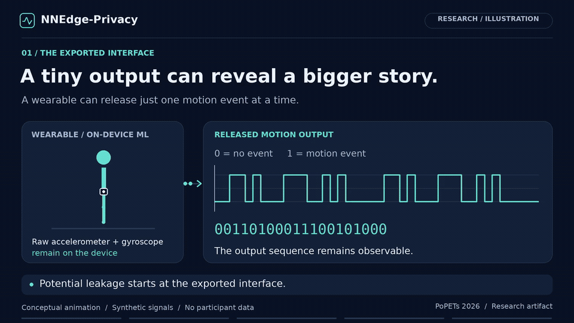

# NNEdge-Privacy: Sensor Side-Channel Attack Analysis

**Sensor outputs can expose private behavior even when raw data stays on the device.** NNEdge-Privacy analyzes sensor side-channel inference attacks against edge AI and multimodal sensing systems. It studies how adversaries recover private activities and behaviors from binary on-sensor ML outputs, accessible inertial sensor streams, and learned cross-modal representations.

This repository contains the research artifact for **[Sensor Privacy as a Spectrum: Quantifying Privacy in Edge and Multimodal Systems through Games](https://petsymposium.org/popets/2026/popets-2026-0124.php)**, published in *Proceedings on Privacy Enhancing Technologies (PoPETs), 2026(4), pp. 341–357*.

[Paper PDF](https://petsymposium.org/popets/2026/popets-2026-0124.pdf) · [DOI](https://doi.org/10.56553/popets-2026-0124)

## See the privacy risk

[](docs/assets/sensor-side-channel.mp4)

**A coarse sensor output can become a window into everyday behavior.** This
30-second animation illustrates an attacker estimating activities from motion
events, the possible exposure of a daily routine, and the MMBIND representation
attack. All signals and activity estimates are synthetic illustrations, not
participant recordings or experimental results.

[Watch or download the MP4](docs/assets/sensor-side-channel.mp4) ·
[Text transcript and rendering instructions](docs/animation.md)

## Attack surface and experiments

The attacker's goal is to infer a private target, such as a person's activity, from the interface available to them. The experiments vary sensor access, temporal continuity, sensor placement, auxiliary knowledge, and representation alignment to measure how each changes attack success.

| Privacy game | Attacker access | Sensor side-channel attack being evaluated |
| --- | --- | --- |
| **G1: Discrete-output adversary** | Binary on-device inference outputs | Infer activities from motion-event statistics, run lengths, transitions, and temporal rhythms, even when raw IMU streams are hidden. |
| **G2: Single-modality adversary** | Accelerometer **or** gyroscope, together with the exposed output | Exploit one accessible continuous sensor channel to improve private activity inference. |
| **G3: Multimodal adversary** | Accelerometer **and** gyroscope, together with the exposed output | Combine motion channels and their correlations to recover more detailed activity information. |
| **G4: Cross-modal representation adversary** | IMU signals or embeddings, with auxiliary cross-modal alignment | Use learned relationships to infer private activity semantics associated with hidden skeleton/video modalities. |

The analysis separates the information present in an exposed interface from the information an attacker can extract using models and context. It compares shuffled windows with temporally coherent sessions, known with unknown placements, and attacks within a dataset with transfer across devices and datasets. Depending on the experiment, reports include accuracy, Macro-F1, mutual information/NMI, Bayes vulnerability, and normalized reverse-KL scores. These measure different aspects of leakage; information scores are not classification accuracy.

## ML-on-sensor hardware

We collected the wearable measurements using STMicroelectronics' **[SensorTile.box PRO (STEVAL-MKBOXPRO)](https://www.st.com/en/evaluation-tools/steval-mkboxpro.html)** platform. The paper describes an on-sensor decision-tree pipeline configured for the **[LSM6DSOX](https://www.st.com/en/mems-and-sensors/lsm6dsox.html)** and its **[Machine Learning Core (MLC)](https://www.st.com/resource/en/application_note/an5259-lsm6dsox-machine-learning-core-stmicroelectronics.pdf)**.

The pipeline produces a compact binary motion output, such as shake/no-shake. This output is the attack surface in G1: an adversary observes an intentionally coarse sensor decision and attempts to recover richer behavioral information. G2 and G3 measure how the attack changes when accelerometer and gyroscope streams also become accessible.

## Datasets

The study combines a new wearable dataset with public smartphone and multimodal benchmarks. Dataset availability and experimental roles differ:

| Dataset | Sensing data | Role in the attack analysis |
| --- | --- | --- |
| **UTAH-STM-HAR — new multimodal dataset; not released yet** | Synchronized accelerometer, gyroscope, binary on-sensor inference outputs, and anthropometric metadata. Eleven participants perform seven activities with five IMUs at the left/right wrists, left/right ankles, and front pocket. | Main G1–G3 analysis of output leakage, temporal context, auxiliary knowledge, and transfer between sensor placements. The dataset is not currently available for public download. |
| **[MotionSense](https://github.com/mmalekzadeh/motion-sense)** | Smartphone accelerometer and gyroscope recordings for six activities. | Cross-device and cross-dataset activity inference; auxiliary data for representation-learning experiments. |
| **[UCI-HAR](https://archive.ics.uci.edu/dataset/240/human+activity+recognition+using+smartphones)** | Waist-mounted smartphone accelerometer and gyroscope recordings for six activities. | Test whether attacks trained on public data transfer to the wearable sensing setup. |
| **[UTD-MHAD](https://personal.utdallas.edu/~kehtar/UTD-MHAD.html)** | Inertial signals with RGB, depth, and skeleton data for 27 actions; inertial placement varies between wrist and thigh according to the action. | Placement-dependent activity/gesture inference and G4 attacks on private semantics through multimodal binding. |
| **[PAMAP2](https://archive.ics.uci.edu/dataset/231/pamap2+physical+activity+monitoring)** | Wearable motion recordings from multiple body locations. | Supporting modality, placement, and activity probes in the `Semantic_Free_Adversary/` pipeline. |
| **[RealWorld](https://www.uni-mannheim.de/dws/research/projects/activity-recognition/dataset/dataset-realworld/)** and **[Shoaib](https://www.utwente.nl/en/eemcs/ps/research/dataset/)** | Activity recordings with accelerometer, gyroscope, and magnetometer channels. | Supplementary MMBIND semantic-transfer experiments with limited labels; RealWorld also supports the identity-linkage probe with MotionSense. |

Obtain public datasets from their linked providers and prepare the layouts expected by the selected branch. The code expects local dataset files; cloning this repository does not supply UTAH-STM-HAR.

## MMBIND experiments: attacking through cross-modal representations

The **[MMBIND branch](https://github.com/iotrustlab/NNEdge-Privacy/tree/MMBIND)** uses **[MMBind](https://github.com/nesl/multimodal-bind)** as an adversarial capability. The security question is whether an attacker can use auxiliary multimodal data to make accessible IMU signals reveal semantics associated with a private, higher-fidelity sensing modality.

For the UTD-MHAD G4 experiment, accelerometer and gyroscope are attacker-visible, while skeleton/RGB modalities are private. Auxiliary alignment provides a bridge during training; **the G4 attacker receives only IMU inputs at inference time** and predicts activity/gesture labels associated with those private modalities. Successful label inference measures a breach of semantic privacy without requiring reconstruction of a video or skeleton stream.

We compare:

- **No alignment:** ordinary IMU-only activity inference as the baseline.
- **Aligned pairs:** use cross-modal correspondence to strengthen the representation available to the attacker.
- **Mismatched pairs:** shuffle correspondence while retaining the paired-data size to test the contribution of alignment.
- **Reduced pairing:** retain 50% or 25% of the paired data to test how much auxiliary exposure the attack needs.

The branch entrypoint is [`MMBIND/run_utd_g4_rebuttal.py`](https://github.com/iotrustlab/NNEdge-Privacy/blob/MMBIND/MMBIND/run_utd_g4_rebuttal.py). It runs the UTD-MHAD ablations and separately reproduces the original MMBind reference protocol, which uses a different test-time modality configuration. The reference result should be interpreted separately from the IMU-only attack.

The paper also explores cross-dataset semantic transfer using MotionSense and Shoaib as auxiliary sources and a small labeled slice of RealWorld for adaptation. A separate identity-linkage experiment asks whether embeddings can link users across RealWorld and MotionSense. Identity linkage did **not** transfer reliably under the evaluated hardware, placement, and collection-protocol shifts. These experiments examine both the reach and the limits of representation-based attacks.

## Experiment branches

**Different branches contain different experiment families.** Select the branch for the attack or ablation you want to study, then follow its README for dependencies, dataset paths, entrypoints, and results. The identity, anthropometrics, and placement branch names describe **auxiliary information available to the activity-inference adversary**.

| Branch | Experiments |
| --- | --- |
| [`main`](https://github.com/iotrustlab/NNEdge-Privacy/tree/main) | G1–G3 attack models, location ablations, and the semantic-free feature-analysis pipeline. |
| [`Non-Semantic`](https://github.com/iotrustlab/NNEdge-Privacy/tree/Non-Semantic) | Activity inference without explicit identity, anthropometric, or placement context; ML/DL model and sampling-rate comparisons. |
| [`Identity`](https://github.com/iotrustlab/NNEdge-Privacy/tree/Identity) | Activity attacks with user identity available and placement information anonymized. |
| [`Identity+Anthrop`](https://github.com/iotrustlab/NNEdge-Privacy/tree/Identity%2BAnthrop) | Add anthropometric knowledge while keeping placements anonymized. |
| [`Identity+Placement`](https://github.com/iotrustlab/NNEdge-Privacy/tree/Identity%2BPlacement) | Activity attacks with identity and sensor-placement context. |
| [`Identity+Anthrop+Placements`](https://github.com/iotrustlab/NNEdge-Privacy/tree/Identity%2BAnthrop%2BPlacements) | Activity attacks with identity, anthropometrics, placement, and cross-sensor context. |
| [`Identity_Placement_Ablation`](https://github.com/iotrustlab/NNEdge-Privacy/tree/Identity_Placement_Ablation) | Train on one placement and evaluate on other placements to test attack generalization. |
| [`STM-HAR-Cross-Sensor`](https://github.com/iotrustlab/NNEdge-Privacy/tree/STM-HAR-Cross-Sensor) | Cross-sensor and UCI-HAR/UTAH-STM-HAR transfer attacks. |
| [`STM-MotionSense-Cross-Sensor-Cross-Dataset`](https://github.com/iotrustlab/NNEdge-Privacy/tree/STM-MotionSense-Cross-Sensor-Cross-Dataset) | Transfer attacks between UTAH-STM-HAR and MotionSense across datasets and placements. |
| [`MotionSense`](https://github.com/iotrustlab/NNEdge-Privacy/tree/MotionSense) | MotionSense/STM reconstruction-based and cross-dataset inference experiments. |
| [`UTD-MHAD`](https://github.com/iotrustlab/NNEdge-Privacy/tree/UTD-MHAD) | Wrist/thigh comparisons for binary, single-channel, and multimodal attacks. |
| [`MMBIND`](https://github.com/iotrustlab/NNEdge-Privacy/tree/MMBIND) | Multimodal binding code and the UTD-MHAD G4 semantic-inference attack ablations. |
| [`new_experiments`](https://github.com/iotrustlab/NNEdge-Privacy/tree/new_experiments) and [`feat/semantics-minigrid-v3`](https://github.com/iotrustlab/NNEdge-Privacy/tree/feat/semantics-minigrid-v3) | Configurable STM experiment grids, class-count comparisons, and sampling-rate/window studies. |

For example, switch to the G4 experiment branch with:

```bash
git fetch origin
git switch MMBIND
```

## Running the main branch

The instructions below apply to `main`. Other branches have their own setup instructions; MMBIND uses a separate PyTorch environment.

### Setup

```bash
python3 -m venv .venv
.venv/bin/python -m pip install numpy pandas scipy scikit-learn matplotlib seaborn tensorflow joblib psutil tqdm
```

### Dataset paths

- For `Game-1/`, `Game-2/`, and `Game-3/`, check the path constants near the top of the selected training script. The random-forest examples below accept `NNEDGE_PRIVACY_STM_ROOT` and otherwise use `STMDATASET/Data/` relative to the repository root.
- For the semantic-free pipeline, update `PAMAP2_ROOT`, `UCI_ROOT`, `STM_ROOT`, and `CACHE_DIR` in [`Semantic_Free_Adversary/data_loader.py`](Semantic_Free_Adversary/data_loader.py). Its defaults expect processed PAMAP2, UCI-HAR, and STM data in sibling directories relative to `Semantic_Free_Adversary/`.
- STM trainers expect processed activity CSVs under `User */Processed/`, including `dec_tree_out_1` for the exposed binary output and the accelerometer/gyroscope columns required by each game.

### Run

After configuring the datasets, run a random-forest adversary for the desired access regime from the repository root:

```bash
.venv/bin/python Game-1/train_rf.py
.venv/bin/python Game-2/train_rf.py
.venv/bin/python Game-3/train_rf.py
```

The game directories also contain decision-tree, naive-Bayes, CNN, RNN, and Transformer adversaries. Their `LocationAblation/` subdirectories contain placement ablations.

To generate feature caches and run the semantic-free modality/placement probe, use its directory as the working directory so the relative cache paths resolve consistently:

```bash
cd Semantic_Free_Adversary
../.venv/bin/python data_loader.py
../.venv/bin/python logreg_modality_classifier.py
```

### Results

- Semantic-free feature caches: `Semantic_Free_Adversary/Cache/`.
- Semantic-free reports: `Semantic_Free_Adversary/Results/`.
- G1–G3 reports and model artifacts: the output path configured in the selected trainer; the random-forest examples write below the STM dataset root in `Results/Game-1/RF/`, `Results/Game-2/RF/`, or `Results/Game-3/RF/`.
- MMBIND ablation summaries, manifests, and logs: `results/` on the `MMBIND` branch.

## Citation

If you use this artifact, please cite the paper and the original datasets or MMBind implementation used in your experiments.

```bibtex
@article{paul2026sensorprivacy,
  title   = {Sensor Privacy as a Spectrum: Quantifying Privacy in Edge and Multimodal Systems through Games},
  author  = {Paul, Jainta and Bovero, Miles and Saha, Swapnil and Chowdhary, Mahesh and Soni, Pratik and Garcia, Luis},
  journal = {Proceedings on Privacy Enhancing Technologies},
  volume  = {2026},
  number  = {4},
  pages   = {341--357},
  year    = {2026},
  doi     = {10.56553/popets-2026-0124},
  url     = {https://petsymposium.org/popets/2026/popets-2026-0124.php}
}
```
